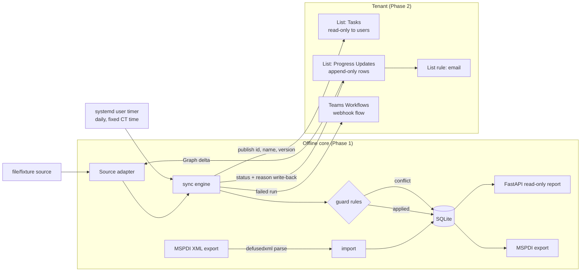

# schedule-guard: plan

Drafted: 2026-10-23. Status: **approved** by the repo owner on 2026-10-23;
decisions recorded in §15 on 2026-10-29. Implementation starts with M0.

Goal: a portfolio-grade Python service that proves field progress updates can
never overwrite a project's master schedule or its baseline.

Scope of release: **v1.0 = Phase 1 + Phase 2**, plus a README with an
architecture diagram and an outline for a field-log post. Phase 3 is dropped
from this project (§10, Q9).

Microsoft Learn claims were checked on 2026-10-23 with the microsoft-learn MCP.
Each one cites a source `[L#]` (list at the end). Claims marked **UNVERIFIED**
have no first-party Learn page that confirms them, or Learn says nothing either
way. Each one has a milestone that checks it.

---

## 1. Principles

1. **Two things are protected.** The *master schedule* (the planned fields
   of each task) and the *baseline* (saved snapshots of planned values). Sync
   never writes either one. Only an import or an explicit admin command does.
2. **Progress fields only.** An update may change only: % complete, actual
   start, actual finish, remaining work, notes. If an update touches anything
   else, it is a conflict.
3. **Optimistic concurrency.** Every update names the task version it was made
   against. If that version is not current, the update is a conflict.
4. **All or nothing per update.** If one field of an update is not allowed,
   none of its fields are applied.
5. **Exactly once.** Idempotency key = source + source item id + item version.
   Applying an update and recording its outcome happen in one SQLite
   transaction, so a key can never be applied twice.
6. **Conflicts are never applied.** They wait for a person to review them.
   Review can only dismiss a conflict with a note. To change the schedule
   itself, the scheduler edits it in MS Project; in v1.0 the changed
   schedule goes into a fresh project database. Re-import into a
   non-empty project is out of scope (Q14).
7. **Untrusted input everywhere.** MSPDI files, update files, and list rows
   are all parsed defensively.
8. **Least privilege.** Phase 2 gets write access to two named lists only.
   The service never holds `Sites.Read.All`, `Sites.ReadWrite.All` or
   `Sites.FullControl.All`. Single exception (Q12): `Sites.Selected` with
   write on the demo site only, if the M9 spike shows list-level access
   fails, and only after the spike results are shown to the repo owner.

## 2. Architecture



Everything runs on one Linux PC. All network calls go out from it: Graph,
the Entra token endpoint, and the Workflows trigger URL. Nothing listens for
inbound traffic. The report binds to `127.0.0.1` and answers only a Host
of `127.0.0.1` or `localhost`.

### Layout (`[M0]`–`[M7]` = exists since that milestone; everything else comes in later runs)

```
pyproject.toml, uv.lock              [M0] uv-managed, Python 3.12
README.md                            [M6] Phase 1 section
.github/workflows/ci.yml             [M6] the suite on GitHub Actions (`uv run --locked pytest -q`) for pull requests and pushes to main, on Ubuntu 24.04's Python 3.12 with uv 0.11.15; actions pinned by commit SHA
.github/dependabot.yml               [M6] monthly update PRs for those two actions' pins (GitHub Actions only)
CLAUDE.md                            [M0] stack, commands, map, invariants
.claude/skills/domain/               [M0] ontology, glossary
specs/001-offline-core/              [M0] spec, plan, tasks for M1–M6
specs/002-export/                    [M7] spec, plan, tasks for M7
src/schedule_guard/                  [M0]
  __init__.py                        [M0] package version
  cli.py                             [M0] argparse entry point: `schedule-guard ...` (the Phase 1 commands below)
  mspdi/parse.py                     [M1] safe MSPDI reader (defusedxml)
  mspdi/export.py                    [M7] progress-only MSPDI writer: `export`, read-only on the database
  store/schema.sql, store/db.py      [M2] SQLite schema, read-only triggers; open/migrate, transactions, read-only open (M5)
  importer.py                        [M2] `import` into an empty database
  baselines.py                       [M2] `baseline lock`, `rebaseline`
  clock.py                           [M3] injectable clock; today is the America/Chicago date
  guard.py                           [M3] pure rules: (task state, update) -> outcome
  progress.py                        [M3] load a task's state, apply an outcome to task_progress
  sync.py                            [M4] runs, idempotency, rerun, the lock file
  review.py                          [M4] list conflicts, dismiss one with a note
  sources/base.py                    [M4] SourceAdapter protocol, strict JSON
  sources/file.py                    [M4] Phase 1 file/fixture source
  sources/graph.py                   Phase 2 delta source
  graph/auth.py, graph/client.py     Phase 2: certificate auth, paging, retries
  publish.py                         Phase 2: Tasks list publisher + write-back outbox
  alerts/workflows.py                Phase 2: failed-run post to Workflows URL
  report/app.py, report/templates/   [M5] read-only HTML report
  demo.py                            [M5] builds the demo database for the report
scripts/make_fixture.py              [M1] deterministic fixture generator
tests/fixtures/                      [M1] generated MSPDI + update files (fake data only; `riverbend-clinic.xml`, `updates/week-44.jsonl`, `demo-updates.jsonl` so far)
tests/                               [M0] unit, property (Hypothesis), report tests (`test_smoke.py`, `test_fixture.py`, `test_mspdi_parse.py`, `test_store_triggers.py`, `test_import.py`, `test_baselines.py`, `test_clock.py`, `test_guard_rules.py`, `test_progress.py`, `test_sources.py`, `test_sync.py`, `test_review.py`, `test_report.py`, `test_demo.py`, `test_hygiene.py`, `test_export.py`, `conftest.py`, `properties/` so far)
deploy/systemd/                      user .service + .timer (Phase 2)
docs/tenant-setup.md                 Phase 2 runbook for the tenant admin
docs/spike-graph-selected.md         Phase 2 spike results
docs/field-log-outline.md            post outline (v1.0)
```

CLI (Phase 1):

| Command | Effect |
| --- | --- |
| `schedule-guard import --db <path> <file.xml>` | Parses the MSPDI file, then stores the project, master schedule, baselines and raw file bytes. Works only on an empty project. |
| `schedule-guard baseline lock --db <path> [--number N]` | Locks a baseline that was imported (Baseline 0 by default). Locked baselines are read-only. |
| `schedule-guard rebaseline --db <path> --confirm --reason "..."` | Admin only. Appends a new baseline number built from the current planned values, and locks it. Old baselines never change (Q7). Refuses past baseline number 10 (Project's Baseline + Baseline1–10: **UNVERIFIED**, [L14] gives no range; M7 had no real Project export to check it against, Q1). |
| `schedule-guard sync now --db <path> --source file:<path>` | Runs a sync immediately. Records a run with an id. |
| `schedule-guard sync daily --db <path> --source file:<path>` | Same as `sync now`, labelled `daily`. The timer calls this one. |
| `schedule-guard rerun --db <path> <run-id>` | Reprocesses the source items that run captured. Keys already decided count as duplicates. Records a new run with `rerun_of`. Refuses a run that captured nothing. |
| `schedule-guard runs list --db <path>` / `conflicts list --db <path> [--all]` / `conflicts dismiss --db <path> <id> --note "..."` | Inspect runs and conflicts. Dismiss a conflict with a note; it is never applied. |
| `schedule-guard report --db <path> [--port 8000]` | Serves the read-only HTML report on 127.0.0.1 only. Ctrl+C, SIGTERM or SIGHUP stops it: exit 0 once it listens, 130 before, also under `uv run` (two exceptions: §7). |
| `schedule-guard demo [--db <path>] [--port 8000]` | Builds a new demo DB from the fixture and scripted updates (some applied, some conflicts), then serves the report on it. The path must not exist; without `--db` the DB lives in a temporary directory, removed when the demo stops on Ctrl+C, SIGTERM or SIGHUP (a SIGKILL leaves it). |
| `schedule-guard export --db <path> --out <file>` | Phase 2 (offline, M7). Writes the imported MSPDI file with each task's progress fields from the database and the baselines `rebaseline` added; the master schedule and the imported baselines stay C14N-identical (P7). Reads the database only. The file must not exist (Q97). |

Every command that uses the database takes `--db <path>` (required; `demo`
builds a new one, in a temporary directory if `--db` is left out); the
file lives outside the repo or in a gitignored path (§4). In Phase 1, `sync`
also needs `--source file:<path>`, a JSON Lines update file (§6).

Runtime deps: `fastapi`, `uvicorn`, `jinja2`, `defusedxml`. Phase 2 adds `msal`
and `httpx`. Dev deps: `pytest`, `hypothesis`, `httpx` (for TestClient).
M0 resolves and locks these from PyPI once (Q13). The lock is resolved with
`[tool.uv] exclude-newer = "2026-10-22T00:00:00Z"` in `pyproject.toml`, so
no package uploaded after that cutoff is used (Q19). Later runs sync from
`uv.lock`; any new dependency or a later cutoff is asked for first.

## 3. Domain terms (canonical copy: `.claude/skills/domain/`, from M0)

| Term | Meaning | Not to be confused with |
| --- | --- | --- |
| **Project** | One imported MSPDI schedule. | |
| **Task** | A `<Task>` with a unique `UID` [L14]. | Tasks *list* (Phase 2 SharePoint list) |
| **Master schedule** | The planned fields of each task: name, WBS, outline, summary/milestone flags, Start, Finish, Duration, Work, predecessors. Only `import` writes it. | Baseline |
| **Baseline** | A numbered snapshot of planned values per task (`<Baseline><Number>` with Start/Finish/Duration/Work/Cost) [L14]. Append-only. | Master schedule |
| **Locked baseline** | A baseline whose rows are read-only (enforced by DB triggers). | |
| **Progress fields** | The allowlist: `percent_complete`, `actual_start`, `actual_finish`, `remaining_work`, `notes`. They map to MSPDI `PercentComplete`, `ActualStart`, `ActualFinish`, `RemainingWork`, `Notes` [L14]. | |
| **Task version** | An integer that rises by 1 each time an update is applied to the task. | Item version |
| **Progress update** | One submitted change: task id, made-against version, fields. | |
| **Source / source item / item version** | Where updates come from (file, Graph list), the item's id there, and its version there. | Task version |
| **Idempotency key** | `(source, source_item_id, item_version)`. | |
| **Outcome** | `applied`, `conflict`, or `duplicate` (key seen before, no effect). | |
| **Conflict** | A stored record of an update that was not applied, with a reason code. Status `open` or `dismissed`. | |
| **Sync run** | One execution of sync. Has an id, a trigger (`now`, `daily`, `rerun`), counts, a status and an error. | |
| **Re-baseline** | The admin command that appends a new baseline number. Sync never does this. | |

Forbidden synonyms: "plan" for baseline, "edit" for update, "job" for run.

## 4. Data model (SQLite)

```
project(id PK, name, source_sha256, source_xml BLOB, imported_at,
        import_finished_at NULL)          -- set once, last step of import
    WITHOUT ROWID (import assigns the id)
    trigger: BEFORE DELETE -> RAISE(ABORT)
    trigger: BEFORE UPDATE -> ABORT unless the only change is
             import_finished_at going from NULL to a value (the id, raw
             bytes, hash and every other column never change)
    trigger: BEFORE INSERT -> ABORT when any project row exists (a
             database holds one project, Q14, so an existing key is
             refused too)

task(project_id, uid, name, wbs, outline_level, is_summary, is_milestone,
     planned_start, planned_finish, planned_duration, planned_work,
     plan_c14n BLOB,                         -- canonical bytes of planned elements
     PRIMARY KEY(project_id, uid)) WITHOUT ROWID
    trigger: BEFORE UPDATE / DELETE -> RAISE(ABORT) (import inserts only)
    trigger: BEFORE INSERT -> RAISE(ABORT) unless the project exists and
             its import_finished_at is NULL (no new tasks after import),
             and when the primary key already exists

baseline(project_id, number, locked_at NULL, locked_by, reason, created_at,
         PRIMARY KEY(project_id, number)) WITHOUT ROWID
    trigger: BEFORE DELETE -> ABORT; BEFORE UPDATE -> ABORT unless the only
             change is the one-time lock: locked_at (with locked_by) going
             from NULL to a value
    trigger: BEFORE INSERT -> ABORT when the primary key already exists,
             the project does not exist, the row is already locked
             (locked_at or locked_by set), or its number isn't an integer
             from 0 to 10 (the cap is UNVERIFIED: no real export, Q1)
baseline_task(project_id, number, task_uid, start, finish, duration, work, cost,
              xml_c14n BLOB,                 -- C14N bytes of the <Baseline> subtree
              PRIMARY KEY(project_id, number, task_uid)) WITHOUT ROWID
    trigger: BEFORE UPDATE / DELETE -> RAISE(ABORT)
    trigger: BEFORE INSERT -> RAISE(ABORT) unless that baseline exists with
             locked_at NULL and the task exists (a locked baseline gets no
             new rows), and when the primary key already exists

task_progress(project_id, task_uid, version INTEGER NOT NULL,
              percent_complete, actual_start, actual_finish, remaining_work, notes,
              last_update_id, PRIMARY KEY(project_id, task_uid))
    import seeds one row per task with the file's progress values at
    version 0; not protected (an applied update writes it)

source_update(id PK, source, source_item_id, item_version, task_uid,
              made_against_version, fields_json, submitted_at, submitted_by,
              raw_json, problem NULL, first_seen_run_id,
              UNIQUE(source, source_item_id, item_version))
    problem: why the item can't be decided (not JSON, no usable key), so a
    rerun records the same malformed conflict without the source file
outcome(update_id PK -> source_update, status, reason_code, detail,
        run_id, decided_at, before_json, after_json)
    status applied or conflict; a duplicate writes no outcome
    before_json, after_json: an applied update's version and progress
    fields, without the task's notes; after_json's notes_entry is the
    entry it appended, or null
conflict(id PK, update_id UNIQUE, reason_code, detail,
         status CHECK(status IN ('open','dismissed')), reviewed_at, note)

sync_run(id TEXT PK,                         -- UUID4
         trigger, rerun_of NULL, source, started_at, finished_at,
         status CHECK(status IN ('running','ok','failed','interrupted')),
         seen, applied, conflicts, duplicates, error)
    interrupted: left running by a killed run, marked by the next run to
    start, which holds the lock. A live run can be
    marked too, and then ends ok or failed, if the next run takes another
    lock file: through a hard link to the DB file (section 5), or after the
    lock file was deleted or the DB renamed while the live run held it
run_item(run_id, update_id, PRIMARY KEY(run_id, update_id))  -- what a run captured
source_cursor(source PK, cursor)             -- Phase 2: deltaLink
writeback(update_id PK, target, payload_json, attempts, done_at,
          etag_after)                         -- Phase 2 outbox
```

With SQLite's default `recursive_triggers = OFF`, a REPLACE deletes the row
it conflicts with without firing that row's DELETE trigger, and no UPDATE
trigger fires. So every unique key on `project`, `task`, `baseline` and
`baseline_task` would be a way to unlock a baseline or delete a protected
row. Two parts close it:

1. **Existing-key triggers.** Every BEFORE INSERT trigger above refuses a
   primary key that already exists, so `INSERT OR REPLACE` with an
   existing key aborts.
2. **No other unique key.** The four tables are WITHOUT ROWID, so there is
   no hidden rowid: `INSERT OR REPLACE ... (rowid, ...)` with an existing
   row's rowid and a new key fails with "table <t> has no column named
   rowid", and `UPDATE OR REPLACE ... SET rowid = ...` fails with "no such
   column: rowid". They carry no unique index of any kind besides their
   primary key: no UNIQUE constraint and no `CREATE UNIQUE INDEX`, partial
   or on an expression, because REPLACE deletes through a second unique key
   the same way. The two allowed updates (the import flag and the baseline
   lock) keep the primary key, so `UPDATE OR REPLACE` can't conflict
   either. A schema check covers both: `PRAGMA table_list` shows `wr` = 1
   for the four tables, and every `PRAGMA index_list` row with `unique` = 1
   has origin `pk` (a UNIQUE constraint shows origin `u`, a
   `CREATE UNIQUE INDEX` origin `c`).

None of this depends on a pragma. It holds on any connection that leaves
triggers enabled (the default). A connection can switch triggers off
(`SQLITE_DBCONFIG_ENABLE_TRIGGER`, or `.dbconfig enable_trigger off` in the
`sqlite3` shell); like dropping a trigger, that takes someone who can
already write the DB file, which Phase 1 doesn't guard against (ontology
Roles). The M2 tests run with the default settings.

The DB file lives outside the repo, or in a gitignored path. It holds the
deltaLink, which contains site and list ids.

## 5. Guard rules

The checks run in this order. The first one that fails decides the outcome.
All of them run inside one `BEGIN IMMEDIATE` transaction per update, together
with writing the outcome.

| # | Check | Outcome / reason code |
| --- | --- | --- |
| G0 | The idempotency key already has an outcome. | `duplicate` (no write, not a conflict) |
| G1 | The payload is malformed: missing task id or version, wrong types, unknown encoding, a submitter name over 100 characters. | conflict `malformed` |
| G2 | The task UID doesn't exist in the project. | conflict `unknown_task` |
| G3 | Any field is outside the allowlist, e.g. `planned_finish`, `name`, a baseline field, or an unknown column. | conflict `field_not_allowed` (all fields of the update listed) |
| G4 | `made_against_version` ≠ the task's current version. | conflict `stale_version` |
| G5 | A value is out of range or the wrong type: % complete outside 0–100, unparseable date, negative remaining work, or an actual start/finish later than today (Q6; "today" is an injectable clock). A note over 4,000 characters, or one that would take the task's notes past 100,000 characters once appended. | conflict `invalid_value` |
| G6 | After merging with current values: `actual_finish` is before `actual_start`, or % complete is 100 without an `actual_finish` (Q6). | conflict `inconsistent_actuals` |
| G7 | The target is a summary task. Project rolls summary tasks up from their subtasks (Q4). | conflict `summary_task` |
| G8 | Phase 2 only: the same `source_item_id` was already decided at a different item version, so a user edited the row in place. | conflict `edited_after_submit` |
| — | Otherwise | `applied`: write the progress fields, bump `version` by 1, store before/after (without the task's notes; after holds the appended entry) |

Rules that hold no matter which check fires:

- Sync code has no write path to `task`, `baseline` or `baseline_task`. The
  DB triggers enforce this a second time.
- Within one run, updates are processed in `(submitted_at, source_item_id)`
  order. If two updates were made against the same version, the first is
  applied and the second becomes `stale_version`. This is intended.
- `notes` is appended as `[date, source, submitter] text`. It never replaces
  existing text (Q3).
- Re-baselining exists only as `rebaseline --confirm --reason`. It appends.
  The sync, rerun and report code paths never import or call it.
- A rerun never turns a conflict into an apply. Conflict keys already have
  an outcome, so G0 returns `duplicate`.
- Each item is processed in its own transaction. If a run crashes halfway,
  rerunning it finishes the items that have no outcome yet. Concurrent runs
  (timer plus a manual `sync now`) are blocked by an `fcntl` lock file next to
  the DB, named from its resolved path, so a `--db` given through a symlink
  shares it. A hard link to the DB file still gets its own lock file. The
  OS releases the lock if the process dies. A run that crashed
  stays `running` until the next run starts, which marks it `interrupted`.
  A rerun of a run that captured nothing is refused.
- No line stops a run. A line the source can't decode as strict JSON (no
  NaN or Infinity, no key twice, no lone-surrogate escape in any string) or
  key is one `malformed` conflict, keyed by its bytes, and the other lines
  are decided as usual.

## 6. Import, MSPDI safety and the fixture

- Parse with `defusedxml.ElementTree` with `forbid_dtd=True`. Entities and
  external references are forbidden by default. Files over 20 MB and files
  with more than 10,000 tasks are rejected. The root must be `Project` in
  namespace `http://schemas.microsoft.com/project`.
- Only the subset we need is read: Task `UID`, `Name`, `WBS`, `OutlineLevel`,
  `Summary`, `Milestone`, `Start`, `Finish`, `Duration`, `Work`, the progress
  elements, `PredecessorLink`, and `Baseline` children (`Number`, `Start`,
  `Finish`, `Duration`, `Work`, `Cost`) [L14]. Everything else is kept
  untouched in the stored raw bytes.
- No full XSD validation. The schema ships in the Project 2007 SDK download
  [L14], not on Learn, and this plan downloads nothing.
- Baseline bytes = `xml.etree.ElementTree.canonicalize` (C14N 2.0, stdlib) of
  each `<Baseline>` subtree, stored per task. Plan bytes (`task.plan_c14n`)
  = the same C14N of the task's master-schedule elements (`Name`, `WBS`,
  `OutlineLevel`, `Summary`, `Milestone`, `Start`, `Finish`, `Duration`,
  `Work`, each `PredecessorLink`), in file order, under one `<Task>`.
- Inside a `<Baseline>` or a master-schedule element only MSPDI-namespace
  elements are allowed, with no attributes and at most 3 levels below the
  Baseline or PredecessorLink; anything else is refused before C14N. The
  stdlib C14N writer searches its namespace list once per name and its
  stack once per level, so thousands of namespaces would take quadratic
  time, and nesting near Python's recursion limit about 6 times as long. A
  Baseline `Number` runs from 0 to 10. That a real Project export stays
  inside all of these is **UNVERIFIED** (no real export, Q1); M7 couldn't
  check it either.
- The C14N bytes are those of the subtree as ElementTree writes it out
  again, so a carriage return in text (`&#13;` in the file) is stored there
  as a line feed. The values read into the other columns, such as
  `task.name`, keep the carriage return.
- **Fixture**: `scripts/make_fixture.py` is seeded and deterministic. It writes
  `tests/fixtures/riverbend-clinic.xml`: a fictional ~40-task clinic build by
  "Example Builders Co." in phases Site work, Foundations, Structure, Envelope,
  MEP rough-in, Interiors and Closeout. It has 5 milestones (Notice to proceed,
  Foundations complete, Dry-in, Substantial completion, Final completion),
  predecessor links and Baseline 0. It has no resources or assignments, so
  assignment-level values can't contradict task-level progress (see
  Challenge C5). A test regenerates the file and asserts the bytes are
  identical.
- **Update files** (`tests/fixtures/updates/*.jsonl`), one JSON object per
  line: `source_item_id`, `item_version`, `task_uid`, `made_against_version`,
  `fields{}`, `submitted_at`, `submitted_by` (fake crew names). The file
  source returns every line on every run. That is deliberate: it exercises
  idempotency.
- No real Project export: the repo owner has no MS Project desktop (Q1). The
  generated fixture is the only MSPDI input.

## 7. Report (FastAPI, read-only)

- GET-only routes: `/` (summary), `/tasks` (planned vs actual with baseline
  variance), `/overdue`, `/milestones`, `/conflicts`, `/runs`. Any other
  method is 405.
- Variance is planned minus a baseline, in calendar days: the newest
  baseline `rebaseline` added, else Baseline 0. An imported baseline with
  a higher number is never used, since a file can keep an archive there.
  Each page with variance names the number used, or says there is none.
- Overdue means a leaf task with planned finish < today and % complete
  < 100. "Today" is injectable so tests are deterministic. A summary
  task's % complete is shown as imported, since Project rolls it up (Q4),
  so summary tasks stay on `/tasks`, marked, and are never listed as
  overdue.
- Host check: the report listens on 127.0.0.1 and answers only a Host of
  `127.0.0.1` or `localhost` (any port), through Starlette's
  `TrustedHostMiddleware`; any other Host gets 400 on every route, so a
  page that points its own domain at 127.0.0.1 (DNS rebinding) can't read
  the report. There is no `--host` option.
- Read-only: each page opens the DB with `mode=ro` and `query_only`, so
  SQLite refuses any write, and reads one snapshot. The report code has no
  INSERT, UPDATE, DELETE or DDL and imports no command that writes.
- Server-rendered Jinja2 with autoescape on, never `|safe`. No JS, no forms,
  no mutation routes, FastAPI's docs pages off, and a
  Content-Security-Policy that allows only inline style. Tests assert
  POST/PUT/PATCH/DELETE return 405, that a foreign Host gets 400, that a
  task name and a note holding `<script>` are escaped, and that a GET of
  every route leaves the DB file byte-identical.
- Stopping: Ctrl+C, SIGTERM or SIGHUP stops `report` and `demo`. Once the
  server listens, that is exit 0 and no traceback, after uvicorn has shut
  down. Before it listens (the demo build, the FastAPI and uvicorn import,
  `create_app`), that is one line on stderr and exit 130. A stop signal
  within 1 s of the first is the same stop and is dropped, so both outcomes
  hold under `uv run` too, which hands the command a terminal's Ctrl+C
  twice, about 0.2 s apart; uvicorn's own handler sees only the first. A
  second Ctrl+C more than 1 s later forces the exit, as uvicorn does. The
  demo's temporary directory (no `--db`) is removed with the three signals
  blocked, so a stop can't cut that short, and once the command has ended
  after a stop they are ignored until the process exits. Two cases still
  differ. A stop in roughly the first 0.1 s, during interpreter start-up
  and the CLI's imports, before it has installed its handlers, comes before
  any demo directory exists. SIGTERM or SIGHUP ends the process by the
  signal with no line. SIGINT depends on when it lands: before Python has
  its own handler it ends the process by the signal with no output; while
  Python imports its `site` module it exits 1 with a "Fatal Python error"
  (mostly init_import_site); after that it mostly ends the process by the
  signal with Python's KeyboardInterrupt traceback. Now and then, most often
  just after the `site` import, the interrupt lands in start-up code whose
  errors Python only prints, as "Failed checking if argv[0] is an import
  path entry" with a KeyboardInterrupt traceback from zipimport, or as
  "Exception ignored in: ..." from importlib, and the command runs on, so `demo` builds its database and serves
  (measured 2026-11-08 on one Linux machine with the system Python 3.12:
  about 0–4 ms, about 5–6 ms, then from about 7 ms until the handlers were
  in at about 60–70 ms; it ran on in about 2 runs in 100 between about 6
  and 10 ms, and once at 30 ms). A stop that lands inside the FastAPI and pydantic import (pydantic-core turns the
  KeyboardInterrupt into its own error) prints a traceback and exits 1; the
  directory is still removed. A SIGHUP that was
  already ignored (nohup) stays ignored, so the server keeps running. A
  SIGKILL can't be caught and leaves the directory in the system's
  temporary directory.
- `demo` writes a new DB from the fixture plus `demo-updates.jsonl` (fake
  "(demo)" crews), never into an existing file, with a fixed demo clock.
  The result has applied progress, overdue tasks, two reached milestones and
  open conflicts of seven kinds, which is enough for screenshots. There is
  no hosted public demo.

## 8. Test strategy (the oracle)

Command: `uv run pytest -q`. Every milestone's proof is that command, plus the
specific tests it names.

Property tests (Hypothesis). Strategies generate arbitrary sequences of
updates: valid, stale, duplicate, unknown task, forbidden fields, bad values,
and mixed fields. Each test runs them through the real sync engine on a
temp-file SQLite DB loaded from the fixture: each example writes batches of
updates to an update file and runs `sync` once per batch, earlier lines
coming back as duplicates.

| ID | Property |
| --- | --- |
| P1 | **Baseline is byte-identical.** Concatenated `baseline_task.xml_c14n` (ordered) plus `project.source_xml` give the same bytes and SHA-256 before and after any sequence, and every column of every `baseline` and `baseline_task` row is unchanged (a write to a column such as `baseline_task.finish` leaves the C14N bytes alone). |
| P2 | **Master schedule is byte-identical.** Same as P1 for `task.plan_c14n` and every column of every `task` row, such as `planned_finish`. |
| P3 | **Idempotent.** Replaying the sequence, duplicating items, or running sync twice leaves the same state as one pass. |
| P4 | **All or nothing.** Every update gets exactly one outcome. An update with any forbidden field changes no progress field. |
| P5 | **Stale never applies.** No update with `made_against_version` ≠ current version at decision time is ever applied. |
| P6 | **Rerun equivalence.** `rerun <id>` after a run produces only duplicates. After a simulated crash mid-run, it reaches the same final state as an uninterrupted run. |
| P7 | Phase 2: **export round-trip.** Every imported `<Baseline>` subtree of the exported MSPDI is C14N-identical to the import, each `<Baseline>` that `rebaseline` added is C14N-identical to its `baseline_task.xml_c14n` (Q39), and every non-progress task element is C14N-identical to the import. |

Plus:

- A `RuleBasedStateMachine` that interleaves submit, sync, rerun, dismiss
  conflict and lock baseline, and checks P1–P5 as invariants after every step.
  A lock may change only `baseline.locked_at` and `locked_by`, and no
  `baseline_task` row.
- A property that puts arbitrary lines between valid ones: lone-surrogate
  escapes, nesting at the decoder's limit, huge numbers, bytes that aren't
  UTF-8. Every run ends ok, every line gets an outcome and every valid line
  applies.
- **The oracle has teeth.** A test monkeypatches a deliberately broken applier
  that writes `planned_finish` or a baseline field. It asserts P1 or P2
  *fails*, and that the DB trigger raises. This shows the properties can
  detect the bug they guard against. Likewise a broken exporter that also
  writes a planned element, or drops a Baseline, makes P7 fail.
- Unit tests for each guard rule G0–G8.
- Malicious XML tests (billion laughs, XXE file read, external DTD, oversize).
  Each must be rejected without reading any file.
- Fixture determinism, report escaping/405, and CLI smoke tests.
- A public-repo hygiene test. It scans tracked files for GUID-shaped strings,
  `tenant`/`client_secret` assignments (camelCase and acronym-prefixed names
  such as azureClientSecret, aadTenantId and MSALClientSecret too, and
  appSettings key and value pairs), XML elements that hold a value and close
  with the same name (a placeholder in a command doesn't), PRIVATE KEY blocks
  (PGP ones too), and files with any of the seven key suffixes `.gitignore`
  lists. A file in UTF-16 (a BOM, or bytes that alternate between mostly NUL
  and mostly not) is scanned both as UTF-16 and as UTF-8, so an ASCII line
  in it is found too. Every file is also scanned with each run of UTF-16
  text in it (bytes that alternate with NUL) read as UTF-16, so a UTF-16
  line inside a file that reads as UTF-8 is found too. The same file, line
  and kind from more than one decode is one finding.
  Only fixture GUIDs on an explicit allowlist may pass.
- Phase 2 Graph code is tested against recorded JSON responses (paging,
  deltaLink, 410 Gone, duplicate items in the delta feed, deleted items, 412
  on if-match). No test makes a network call.

## 9. Phase 2 (detailed; built after Phase 1)

### 9.1 Tenant shape (the tenant admin sets this up once; runbook in `docs/tenant-setup.md`)

- The existing tenant gets a dedicated Team, "Schedule Guard Demo", with two
  Microsoft Lists pinned as channel tabs (tab pinning: **UNVERIFIED** on Learn;
  done in the UI).
- **Tasks** (the service publishes it; users get Read only): `Title` = task
  name, `TaskUID` (number, indexed), `CurrentVersion` (number).
- **Progress Updates** (append-only, one row per update): `Task` (lookup to
  Tasks), `MadeAgainstVersion` (number), `PercentComplete`, `ActualStart`,
  `ActualFinish`, `RemainingWork` (hours), `Notes` (plain multi-line), and
  `Status` (Pending/Applied/Conflict/Duplicate) plus `Reason`, which only the
  service writes. It also has a demo column, `Proposed Finish` (Q16). The
  service never maps it to a progress field, so any value in it becomes a
  `field_not_allowed` conflict.
- Why append-only: delta "shows the latest state for each item, not each
  change" [L1]. If users edited rows in place, intermediate versions would be
  lost. Rule G8 turns any in-place edit into a conflict, so the guard holds
  even when list permissions allow users to edit their own rows. Users keep
  SharePoint's default rights (Q11).

### 9.2 Identity and permissions

- The service gets its **own app registration**, not shared with any other
  project. Its credential is a **certificate**. The private key lives outside
  the repo. The path to it, plus the tenant, client, site and list ids, live
  in a gitignored `.env` (`.env` is already in `.gitignore`). `.env.example`
  holds placeholders only.
- Requested application permission: **`Lists.SelectedOperations.Selected`**.
  It grants nothing until a list is explicitly assigned a role via
  `POST /sites/{site-id}/lists/{list-id}/permissions` [L2][L3]. Roles are
  `read`, `write`, `owner`, `fullcontrol` [L2]. The service gets `write` on
  the two lists only.
- **Fallback, only if the spike shows list-level access can't work:**
  `Sites.Selected` with `write` on the demo team's site [L2]. Never
  `Sites.Read.All` or `Sites.ReadWrite.All`.
- Assigning app permissions to a list breaks permission inheritance on that
  list [L2]. That is acceptable here, and the tenant admin sets user
  permissions on each list anyway.

### 9.3 First Phase 2 milestone: the Selected-scope spike

What Learn shows:

- The per-API permission tables list only the `Sites.*.All` scopes for the
  calls we need:
  - delta: `Sites.Read.All` least privileged [L1]
  - list items: `Sites.Read.All` [L4]
  - update item fields: `Sites.ReadWrite.All` [L5]
- The Selected overview says an app with `Lists.SelectedOperations.Selected`
  plus a role on the list gets access "if a record is found for the
  application, and the role allows for the operation requested" [L2].

So **whether the Selected scope works for delta, list, create and PATCH is
UNVERIFIED** until we test it. The spike runs with the repo owner's go-ahead
and their `.env`, app-only with the Selected grant. It records results in
`docs/spike-graph-selected.md`:

1. `GET /sites/{id}/lists/{id}/items?expand=fields` on both lists.
2. `GET /sites/{id}/lists/{id}/items/delta`: page through `@odata.nextLink`
   until `@odata.deltaLink`, add a row, then call the deltaLink again [L1].
3. `POST` an item to Tasks and `PATCH .../items/{id}/fields` on an Update row
   with `If-Match: <etag>`. Expect `412` when the eTag is stale [L5].
4. Check that a field user's lookup shows up as a lookup-id field, and decide
   what counts as "item version". Default: the listItem `eTag`, which delta
   returns per item [L1].
5. Confirm a call without the role assignment is denied (control case).

Decision table:

| Result | Then |
| --- | --- |
| Delta works under the Selected grant | Use delta. |
| Delta denied, items list works | **Fallback:** list items with `$filter` on `Modified` greater than the last high-water mark, under the same grant. `$filter` on fields is supported and works best on indexed columns [L4], so index `Modified`. |
| Items list denied at list level | Show the spike results to the repo owner first, then use `Sites.Selected` (write, demo site only; approved in Q12) and repeat the spike. |
| All denied | Stop Phase 2 and report. Never fall back to `Sites.Read.All`. |

### 9.4 Graph source adapter

- First run: full delta enumeration. Store `@odata.deltaLink` in
  `source_cursor`. Later runs call the deltaLink [L1].
- An item can appear more than once in the feed. Use its last occurrence [L1].
- Items with `deleted` are logged. Deleting a row never undoes an applied
  update.
- **410 Gone** (`resyncChangesApplyDifferences` /
  `resyncChangesUploadDifferences`): follow the `Location` header to start a
  fresh enumeration [L1]. That's safe because the list is append-only and
  already-decided keys return `duplicate`. Nothing is ever uploaded back from
  local state.
- Throttling: honour `429`/`503` `Retry-After` with capped backoff
  (**UNVERIFIED this run**; check Graph throttling guidance in M11).
- Certificate client-credentials via MSAL (**UNVERIFIED this run**; check the
  MSAL docs in M11).

### 9.5 Publishing and write-back

- After a run, the service upserts `Tasks` rows (id, name, current version)
  so field users always see the version to quote.
- Status and reason go into a `writeback` outbox in the same transaction as
  the outcome. They are pushed after the local commit with `PATCH .../fields`
  and `If-Match`. If the push fails, it retries next run. The local guard
  decision never depends on Graph succeeding.
- **Own-write tracking:** each write-back creates a new item version. The
  service stores the eTag returned by its PATCH and treats that version as its
  own, so it is skipped rather than flagged by G8. A user edit after that
  produces exactly one `edited_after_submit` conflict. It can't loop, because
  own writes are skipped.

### 9.6 Alerts

- **Conflicts:** status and reason are written onto the Update row, and a
  List rule ("when Status changes to Conflict, email the repo owner") sends
  the email.
  **UNVERIFIED:** Learn has no first-party page on List rules. Whether a rule
  fires on app-made edits needs a test in M13. Fallback: post a conflict
  digest through the same Workflows URL. That needs no extra Graph scope and
  no `Mail.Send`.
- **Failed runs:** a Teams Workflows flow with the trigger "When a Teams
  webhook request is received" posts to the channel [L10][L11]. The trigger
  accepts POST only. Its auth can be "anyone", "any user in my tenant" or
  "specific users"; the tenant options need a bearer token [L11]. Default:
  "anyone", with the URL kept as a secret in `.env` (Q10). Worst case if it
  leaks: a fake alert in the demo channel. Messages stay
  under about 28 KB [L10][L11]. The flow is owned by a user, so add a
  co-owner to avoid an orphan flow [L10].
- **Not used:** app-only `POST /teams/{id}/channels/{id}/messages`. Its only
  application permission is `Teamwork.Migrate.All`, and Learn says it's
  "only supported for migration" [L6].
- **Licence check:** the Microsoft Teams connector is **Standard** class in
  Power Automate [L11]. Microsoft 365 seeded licences include standard
  connectors but not premium ones [L12]. So the Workflows trigger needs no
  Premium licence. Verified.

### 9.7 Export back to MSPDI (offline; first Phase 2 build milestone)

- Re-parse the stored original bytes, set only the five progress elements on
  each task, and serialize with the default namespace registered. Baseline and
  planned elements stay C14N-identical (P7).
- Built in M7 (spec 002): `export --db <path> --out <file>`. A progress
  value equal to the file's leaves its element alone; a new element goes to
  its place in the MSPDI Task sequence (the order is **UNVERIFIED**, C7).
  Each baseline `rebaseline` added is written as a `<Baseline>` element
  with its stored C14N bytes (Q39). A carriage return in text is written as
  `&#13;`. A name outside any namespace is refused, since ElementTree can't
  write it under a default one; so is an attribute in the MSPDI namespace,
  which it would write without its namespace; and so is an existing
  `--out` file (Q97): it is created exclusively, then a temporary file in
  the same folder is renamed over it. Ctrl+C, SIGTERM or SIGHUP while it
  runs removes both and exits 130 with one line; one that comes from the
  rename on, with the file complete, is held, and the export finishes as
  usual (exit 0).
  Imported again, an export turns each Baseline `rebaseline` added into an
  imported one, so the new database's report measures variance against
  Baseline 0, or has no variance baseline if the file has no Baseline 0
  (§7); a re-import is a fresh database (Q14).
- "Openable in Project" needs MS Project desktop to confirm. The repo owner
  doesn't have it (Q1), so the claim stays **UNVERIFIED** (Challenge C3).
- Risk: Project may recalculate dependent fields when it opens the file
  (actual duration, remaining duration). We write only the allowlisted
  elements and document that Project derives the rest.

### 9.8 Host

- systemd **user** units: `deploy/systemd/schedule-guard-sync.service` runs
  `schedule-guard sync daily`, and the `.timer` uses
  `OnCalendar=*-*-* 06:00:00 America/Chicago` (time from Q2;
  `Persistent=true`). Checked on this host on 2026-10-23: systemd 255, and
  user linger is already on, so user timers run without a login session.
  Whether this systemd accepts a timezone in `OnCalendar` stays
  **UNVERIFIED** (not a Microsoft claim); check it in M14.
- Failed runs exit non-zero and post to the Workflows URL. Runs and errors are
  in SQLite and the journal.

### 9.9 Optional

A Power BI Desktop file reading an exported CSV, plus screenshots. Power BI
Desktop is free [L13]. Publishing or sharing needs Pro [L13], so the plan
does neither. This is Windows-only, so the repo owner would do it.

## 10. Phase 3 (dropped, Q9)

Dropped from this project on 2026-10-29: it needs `Sites.Read.All` and a
public HTTPS endpoint, and a daily sync is enough. The field-log post
mentions it under "next". The notes below are kept for that post.

- An optional Graph change notification on the Progress Updates list. Its only
  job is to trigger the same delta sync. Lists are a supported resource
  [L7]. List notifications carry no resource data [L9]. Max subscription
  lifetime for a SharePoint list is 42,300 minutes [L7], so it must be renewed
  before then. It needs a public HTTPS endpoint that answers the
  `validationToken` handshake within 10 seconds and acknowledges
  notifications fast (3 seconds per [L9]).
- **Blocker found:** the create-subscription permission table lists
  `Sites.Read.All` (application) for `list` [L8]. That conflicts with "never
  `Sites.Read.All`". This is why Phase 3 is dropped (Q9).
- It also breaks the "no public inbound endpoint" constraint, which is why it
  stays out of v1.0.

## 11. Milestones (each one worker run and one PR; Phase 1, M0–M6, went to GitHub as one PR, #1)

Sizes: S ≈ small diff, M ≈ medium, L ≈ largest that still fits one reviewed
run.

**Phase 1: offline core**

| # | Run | Size | Proof |
| --- | --- | --- | --- |
| M0 | Scaffold: `CLAUDE.md` (stack, commands, map), `pyproject.toml` (uv, py3.12) + `uv.lock`, package skeleton, one passing test, `.claude/skills/domain/` (ontology + glossary from §3–4), `specs/001-offline-core/{spec,plan,tasks}.md`, `.gitignore` additions (`*.db`, `*.pem`, `*.pfx`, `*.key`, `CLAUDE.local.md`, `.claude/settings.local.json`). Install approved (Q13). | S | `uv run pytest -q` is green. `git status` clean. Diff has no GUIDs, emails or private paths. |
| M1 | Fixture generator + safe MSPDI parser. Malicious-XML tests. | M | Fixture determinism test, parser tests, XXE/billion-laughs rejected. |
| M2 | SQLite schema + read-only triggers + `import`, `baseline lock`, `rebaseline --confirm`. | M | Trigger tests with the default `recursive_triggers = OFF`: direct UPDATE/DELETE on `project`, `task`, `baseline` and `baseline_task` rows raises (except the one-time `import_finished_at` set and the lock, and each of those two raises when paired with a change to any other column, including an `UPDATE OR REPLACE` renumber); INSERT OR REPLACE with an existing key raises on all four tables; INSERT OR REPLACE with an explicit rowid ("table <t> has no column named rowid") and UPDATE OR REPLACE SET rowid ("no such column: rowid") fail on all four (WITHOUT ROWID), and a schema check finds `wr` = 1 in `PRAGMA table_list` for the four tables and that every `PRAGMA index_list` row with `unique` = 1 has origin `pk`; INSERT into a locked or missing baseline, or into `task` after import or for a missing project, raises, and so does a second `project` row or a `baseline` row inserted locked or numbered outside 0–10. Import round-trip of C14N bytes. |
| M3 | Guard engine (pure) with rules G0–G7 + unit tests + P1, P2, P4, P5 + teeth test. | M | Property tests pass. The broken applier makes P1/P2 fail. |
| M4 | `SourceAdapter` + file source + `sync now`/`daily`, run records, lock file, `rerun`, `runs`/`conflicts` CLI + P3, P6 + state machine. | L | All properties are green. Crash-and-rerun test. |
| M5 | Read-only FastAPI report + `demo`. Screenshots taken with the `run` skill or by the repo owner. | M | Report tests (405s, foreign Host 400, escaping, overdue with fixed today, stop signals: exit 0 once listening, 130 before). `demo` serves. |
| M6 | Phase 1 wrap: README "Phase 1" section, hygiene test, docs sync, GitHub Actions workflow running `uv run --locked pytest -q` (Q15; the CI config gets a max-effort review). **Done 2026-11-04;** M0–M6 went to GitHub as one PR (#1), and "in CI" was met by its first run on fd73925 (622 passed, 2026-11-08). | S | Full suite green locally and in CI. Hygiene test passes. |

**Phase 2: tenant integration** (M7 needs no tenant; M8 is the tenant admin's
work; M9 needs the repo owner's go-ahead for live calls)

| # | Run | Size | Proof |
| --- | --- | --- | --- |
| M7 | MSPDI export (offline) + P7. **Done 2026-11-08** (spec 002); "opens in MS Project", the Baseline 0–10 cap and the nesting limits stay UNVERIFIED (Q1). | M | P7 green. The exported file re-imports into an empty project. |
| M8 | `docs/tenant-setup.md` runbook + `.env.example`: app registration with certificate, Team + two lists + columns + user permissions, the one-time grant commands the tenant admin runs (Graph PowerShell, plus the revoke command; Q8), Workflows flow, List rule. Docs only. | S | Docs review. Hygiene test passes. |
| M9 | **Spike** (§9.3) against the demo lists under the Selected grant. Writes `docs/spike-graph-selected.md` with the decision. | S | Recorded request/response shapes (ids redacted). Decision table filled in. |
| M10 | Graph auth (MSAL certificate) + client (paging, retries, 410) + Graph source adapter, tested against recorded fixtures. | L | Tests green offline. No `Sites.*.All` string anywhere in the code (test). |
| M11 | Tasks publisher + write-back outbox + own-write tracking + rule G8. | M | Unit tests for loop-freedom and 412 handling. |
| M12 | First live sync on the demo lists (repo owner's go-ahead): append rows, sync, rerun, check Status/Reason. | S | A run log showing applied, conflict and duplicate outcomes. Baseline hash unchanged. |
| M13 | Alerts: Workflows client for failed runs. Live check that the List rule fires on an app-made edit, otherwise wire the conflict-digest fallback. | S | Captured channel post and email (or fallback post). |
| M14 | Host: systemd user service + timer, linger, runbook. A two-day soak. | S | `systemctl --user list-timers` output. Two daily run records. |
| M15 | v1.0 docs: README with mermaid architecture diagram, licensing and permissions tables, `docs/field-log-outline.md`. Then SHIP (PR). | S | Docs review. Full suite green. |
| (opt) | Power BI Desktop file + screenshots (repo owner, Windows). | S | — |

## 12. Licensing (free vs premium)

| Item | Needed for | Cost class | Source |
| --- | --- | --- | --- |
| Python 3.12, uv, FastAPI, SQLite, pytest, Hypothesis, defusedxml, msal, httpx | Everything | Free (OSS) | — |
| Microsoft Lists / SharePoint / Teams | Phase 2 | Included in the existing M365 licence (assumed) | — |
| Microsoft Graph listItem / list permission APIs | Phase 2 | No extra licence. Not in the metered-API set we use (**UNVERIFIED**) | — |
| Teams Workflows, trigger "When a Teams webhook request is received" | Failed-run alerts | **Standard** connector, included in M365 seeded rights | [L11][L12] |
| Power Automate Premium (HTTP trigger, premium/custom connectors) | — | **Premium: not used** | [L12] |
| List rules (email on change) | Conflict email | Included (**UNVERIFIED**, no Learn page) | — |
| Entra app registration + certificate credential | Phase 2 auth | No extra cost (**UNVERIFIED**) | — |
| Power BI Desktop | Optional dashboard | Free | [L13] |
| Power BI Pro | Publishing/sharing | **Premium: not used** | [L13] |
| MS Project desktop | Optional real export and "openable" check | Paid, optional (Q1) | — |
| Graph change notifications | Phase 3 (dropped) | No licence, but needs a public HTTPS host | [L7] |

## 13. Permissions

| Scope / role | Type | Grant target | Who grants | When |
| --- | --- | --- | --- | --- |
| `Lists.SelectedOperations.Selected` | Application, admin consent | The schedule-guard app registration | The tenant admin | M8 |
| role `write` | Resource grant via `POST /sites/{site-id}/lists/{list-id}/permissions` [L3] | "Tasks" list | The tenant admin, one time, in a delegated Graph PowerShell session (`Connect-MgGraph -Scopes Sites.FullControl.All`, then `New-MgSiteListPermission` [L3]); revoked afterwards (Q8) | M8 |
| role `write` | Same | "Progress Updates" list | The tenant admin, same session | M8 |
| `Sites.Selected` + `write` | Application + site grant | Demo team site only | The tenant admin | **Only if the M9 spike fails at list level**, after the repo owner sees the results (Q12) |
| Workflows trigger URL | Shared secret (not a Graph scope) | The flow on the demo channel | The tenant admin creates the flow | M8 |
| User permissions: Read on Tasks, add rows on Progress Updates | SharePoint list permissions | The two lists | The tenant admin (list owner) | M8 |
| **Never on the service app:** `Sites.Read.All`, `Sites.ReadWrite.All`, `Sites.FullControl.All`, `Teamwork.Migrate.All`, `Mail.Send` | — | — | — | Enforced by a code-level test (M10) |

Who can call the grant API: the API page lists `Sites.ReadWrite.All` as least
privileged, with `Sites.FullControl.All` and `Sites.Manage.All` as higher
[L3]. The Selected overview says managing *list* permissions needs
`Sites.FullControl.All`, `Sites.Selected`+FullControl or
`Sites.Selected`+Owner, and that in delegated calls the user also needs
sufficient rights [L2]. The two pages disagree. Plan for the stronger one:
the tenant admin's one-off delegated session uses `Sites.FullControl.All` on
Microsoft Graph PowerShell, never on the schedule-guard app, and they revoke
that consent afterwards with a command written in the runbook (Q8).

## 14. Challenge list

- **C1 [blocker for M10]** Learn's per-API tables for delta, list items and
  update item list only `Sites.*.All` [L1][L4][L5]. Selected-scope support
  rests on the general statement in the overview [L2]. Resolved by the M9
  spike and its decision table. No Graph adapter work starts before it.
- **C2 [resolved: Phase 3 dropped]** List subscriptions list `Sites.Read.All`
  [L8]. Phase 3 is dropped (Q9).
- **C3 [no oracle, accepted]** "Openable in Project" has no oracle without MS
  Project desktop, which the repo owner doesn't have (Q1). P7 (structural
  round-trip) is the oracle.
- **C4 [resolved in M0]** The domain needs an ontology and glossary: more
  than 3 entities, a conflict status machine, and an authz model. M0 writes
  them into `.claude/skills/domain/` from §3–4, together with `CLAUDE.md`
  and `specs/001-offline-core/`. The authz model is the Roles section of
  `ontology.md` (added 2026-10-29): in Phase 1 the CLI is local, so anyone
  with shell access can run every command.
- **C5 [scoped out]** Real Project files with resource assignments carry
  per-assignment actuals and remaining work. Task-level writes can diverge
  from them. The Phase 1 fixture has no assignments. Supporting assignments
  is out of scope for v1.0.
- **C6 [doc discrepancy]** Who may grant list permissions differs between
  [L3] and [L2]. The plan uses the stronger requirement (§13).
- **C7 [skip]** Full MSPDI XSD validation needs an SDK download. We validate
  the subset we read.

## 15. Decisions

The repo owner approved the plan "with your picks" on 2026-10-23; the answers
were recorded on 2026-10-29. Each question is followed by its answer.

1. **MS Project desktop?** No. Generated fixture only; "opens in Project"
   stays **UNVERIFIED**.
2. **Daily sync time (CT)?** 06:00 America/Chicago.
3. **Notes: append or replace?** Append dated entries. Replace would be an
   erase path.
4. **Summary tasks?** Reject progress on them as `summary_task`. Project rolls
   summaries up.
5. **Stale-version conflicts?** Dismiss only; the field resubmits against the
   current version. Sync stays the one write path to prove.
6. **Validation?** Range/type, finish ≥ start, **and** 100 % needs an actual
   finish, **and** no actual dates later than today (injectable clock).
   Changes G5 and G6 (§5).
7. **Re-baseline: append or replace?** Append a new numbered baseline and keep
   history.
8. **Grant session?** One-time grant from Graph PowerShell
   (`Connect-MgGraph -Scopes Sites.FullControl.All`, delegated), revoked
   afterwards; the revoke command goes in the runbook. Changes §13 and M8.
9. **Phase 3?** Dropped from this project; mentioned under "next" in the
   field-log post. Changes §10 and C2.
10. **Workflows trigger auth?** "Anyone"; the URL is a secret in `.env`. Worst
    case if it leaks: a fake alert in the demo channel.
11. **Progress Updates edit rights?** SharePoint's default rights plus G8.
12. **Spike fallback?** Yes: `Sites.Selected` (write) on the demo site only,
    if list-level access fails, and only after the spike results have been
    shown. Changes the §9.3 decision table.
13. **Installs?** Approved: M0 may run `uv lock` and `uv sync` from PyPI for
    the named deps only. Later runs sync offline from the lock; new deps are
    asked for. `uv` 0.11.13 and `/usr/bin/python3.12` (3.12.3) are installed.
14. **Re-import?** Phase 1 imports into an empty project only. No
    `--replace-plan` for v1.0.
15. **CI?** Yes: GitHub Actions running `uv run pytest -q`, added in M6 (not
    M0). The CI config gets a max-effort review. Changes M6.
16. **"Proposed Finish" demo column?** Yes, so the demo shows
    `field_not_allowed`. Changes §9.1.
17. **Owner's name in this public plan?** No: role names only (the tenant
    admin, the scheduler, the repo owner).
18. **Where does PLAN.md live?** (2026-10-29) It stays at the repo root.
19. **Dependency cutoff?** (2026-10-29) Re-lock with `exclude-newer =
    "2026-10-22T00:00:00Z"` in `pyproject.toml`; packages uploaded after
    the cutoff are not used.

M7 added two decisions on 2026-11-08. They keep the numbers they were asked
under, so the list goes on at 39 and then at 97.

39. **The baselines `rebaseline` added, in the export?** (2026-11-08) Each
    one is written as a `<Baseline>` element after the task's last
    Baseline, in number order, with the bytes `baseline_task.xml_c14n`
    holds. Changes §9.7 and P7 (§8).

<!-- a list of its own, so the number shows as 97 -->

97. **Export to an `--out` file that already exists?** (2026-11-08)
    Refused, and the file is left as it was: `--out` is created
    exclusively, the bytes go to a temporary file in the same folder, and
    that file is renamed over `--out`. There is no `--force`. Changes §2
    and §9.7.

## 16. Field-log post outline (written in M15)

1. The problem: a field app silently moved a planned finish date.
2. Two protected things: the master schedule vs the baseline.
3. The guard in one table: allowlist, version check, all-or-nothing.
4. Proving it: Hypothesis byte-identity properties, and a test that shows
   they fail on a broken applier.
5. Least privilege in M365: Selected scopes, what Learn says vs what the spike
   showed.
6. Alerts without Premium: Workflows webhook, List rules.
7. What I'd do next: change notifications, and why they're out of scope.

## Sources (Microsoft Learn, checked 2026-10-23)

- [L1] listItem: delta. https://learn.microsoft.com/en-us/graph/api/listitem-delta?view=graph-rest-1.0
- [L2] Overview of Selected permissions in OneDrive and SharePoint. https://learn.microsoft.com/en-us/graph/permissions-selected-overview
- [L3] Create permission on a list. https://learn.microsoft.com/en-us/graph/api/list-post-permissions?view=graph-rest-1.0
- [L4] List items. https://learn.microsoft.com/en-us/graph/api/listitem-list?view=graph-rest-1.0
- [L5] Update listItem. https://learn.microsoft.com/en-us/graph/api/listitem-update?view=graph-rest-1.0
- [L6] Send chatMessage in channel. https://learn.microsoft.com/en-us/graph/api/channel-post-messages?view=graph-rest-1.0
- [L7] Set up notifications for changes in resource data. https://learn.microsoft.com/en-us/graph/change-notifications-overview
- [L8] Create subscription (permissions). https://learn.microsoft.com/en-us/graph/api/subscription-post-subscriptions?view=graph-rest-1.0
- [L9] Transform Remote Event Receivers to SharePoint Online webhooks (Graph notifications section). https://learn.microsoft.com/en-us/sharepoint/dev/sp-add-ins-modernize/from-remote-event-receivers-to-webhooks
- [L10] Create Incoming Webhooks (Workflows). https://learn.microsoft.com/en-us/microsoftteams/platform/webhooks-and-connectors/how-to/add-incoming-webhook
- [L11] Microsoft Teams connector reference. https://learn.microsoft.com/en-us/connectors/teams/ (read: the class table, "When a Teams webhook request is received" and the throttling sections; not the whole page)
- [L12] Power Automate seeded licences. https://learn.microsoft.com/en-us/power-platform/admin/power-automate-licensing/deep-dive-on-specific-license
- [L13] Download Power BI Desktop. https://learn.microsoft.com/en-us/power-bi/fundamentals/desktop-get-the-desktop ; Pro needed to publish: https://learn.microsoft.com/en-us/power-bi/create-reports/tutorial-end-to-end-power-bi
- [L14] MSPDI Task element. https://learn.microsoft.com/en-us/office-project/xml-data-interchange/task-element?view=project-client-2016 ; Baseline element: https://learn.microsoft.com/en-us/office-project/xml-data-interchange/baseline-element?view=project-client-2016 ; Tasks schema: https://learn.microsoft.com/en-us/office-project/xml-data-interchange/xml-schema-for-the-tasks-element?view=project-client-2016
